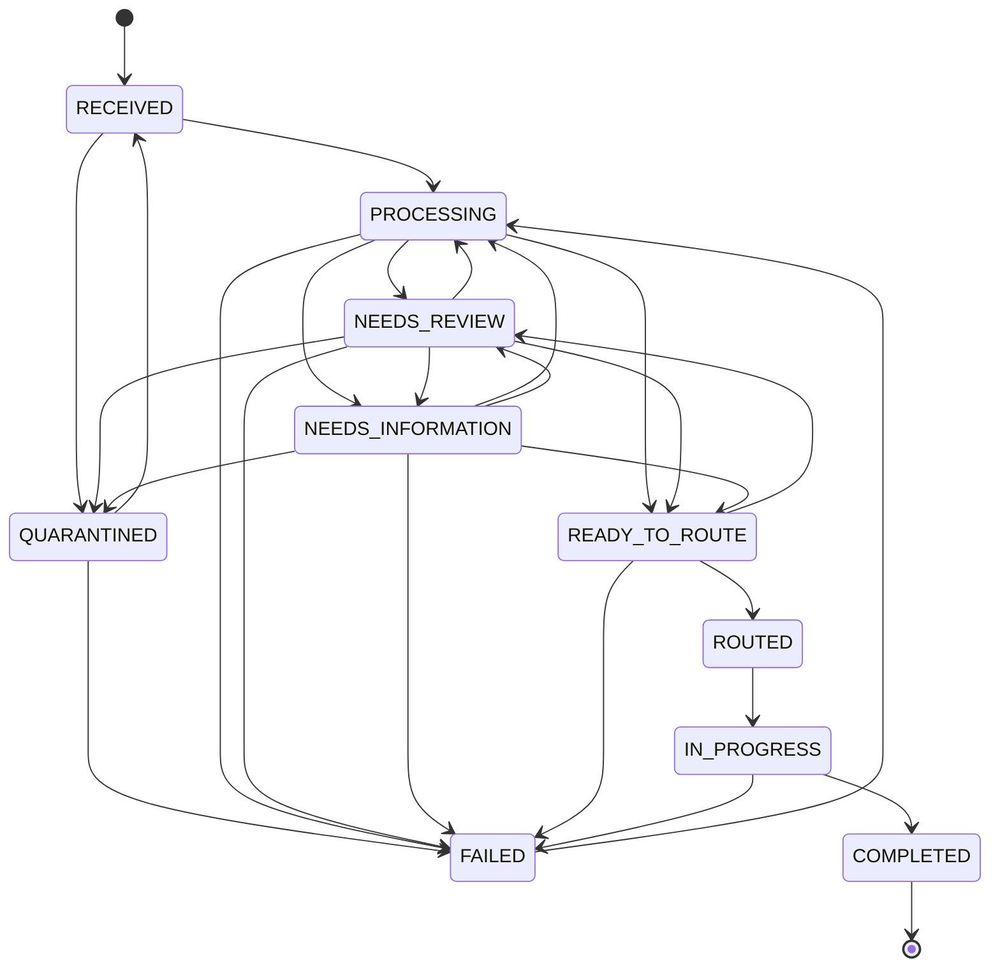

# Referral workflow state machine

Referral status is a typed state with explicit allowed transitions. Clients request task-specific
actions; they cannot submit arbitrary status text to bypass policy.

| State | Meaning | Typical permitted next states |
| --- | --- | --- |
| `RECEIVED` | Referral exists but processing has not begun | `PROCESSING`, `QUARANTINED` |
| `QUARANTINED` | Intake requires a security/validation decision | `RECEIVED`, `FAILED` |
| `PROCESSING` | Extraction, evidence, completeness, or FHIR work is active | Review/information/ready/failed |
| `NEEDS_REVIEW` | A human decision is required | Reprocess, request information, ready, quarantine, failed |
| `NEEDS_INFORMATION` | An authorized reviewer recorded follow-up for missing data/documents | Supply/correct fields, reprocess, review, ready, quarantine, failed |
| `READY_TO_ROUTE` | Deterministic checks passed; an authorized reviewer action may route | Review, routed, failed |
| `ROUTED` | Administrative queue was selected by versioned policy | `IN_PROGRESS` |
| `IN_PROGRESS` | Operational task is being worked | `COMPLETED`, `FAILED` |
| `COMPLETED` | Terminal successful state | None |
| `FAILED` | Explicitly failed with safe operational context | `PROCESSING` for controlled retry |

## Invariants

- AI/model output never supplies a state or transition.
- Routing is permitted only after completeness and required review conditions pass.
- A field correction records the original value, corrected value, reviewer, timestamp, and optional
  reason; it does not silently overwrite extraction history.
- State-changing authorization is enforced server-side using trusted roles and organization scope.
- Every successful important transition creates a durable audit event with a trace/correlation ID.
- Invalid transitions return a structured conflict/error and leave state unchanged.
- Retries must not duplicate FHIR resources or durable audit events representing one logical action.

The source of truth is the typed transition table in the backend domain module. This document must
be updated whenever that table changes.

## Missing-information recovery

`request-information` snapshots missing field paths/document classifications in a safe durable audit
event and transitions a reviewable incomplete referral to `NEEDS_INFORMATION`. It does not contact
an external party. An identical retry while waiting returns the current referral without another event.

An absent required field can be supplied by an authorized reviewer with a mandatory confirmation
reason. The database stores no invented AI proposal (`ai_value` is nullable), and records the human
value, actor, timestamp, and reason separately. Existing fields use the correction action. A repeated
identical supply by the same actor is idempotent; competing values conflict instead of overwriting.

Completeness is recomputed after review actions. Only verified or human-corrected values and processed
document classifications count. Unprocessed supplemental documents, unsupported evidence, low confidence,
and unresolved source conflicts block readiness and routing. A valid final correction/supply may move
`NEEDS_INFORMATION` directly to `READY_TO_ROUTE`. Later contradictory source documents require a new
resolution; reprocessing the same resolved packet preserves the human decision and original proposal.
